<picture>
  <source media="(prefers-color-scheme: dark) and (max-width: 640px)" srcset="assets/waterfall-dark-narrow.svg">
  <source media="(prefers-color-scheme: light) and (max-width: 640px)" srcset="assets/waterfall-light-narrow.svg">
  <source media="(prefers-color-scheme: dark)" srcset="assets/waterfall-dark.svg">
  
</picture>

### Request headers

```http
GET /jwcastillo HTTP/2
host: github.com
x-role: performance engineer
x-location: Santiago, Chile
accept: k6, core-web-vitals, clean-architecture, test-first
x-also: AI agent tooling (Claude Code, Codex, OpenCode, Gemini CLI)
```

I measure before I claim. I load test with k6, keep Core Web Vitals inside their budgets, design systems with Clean and Hexagonal Architecture, and audit AI agent skills with [NVIDIA SkillSpector](https://github.com/NVIDIA/SkillSpector) before sending the fixes upstream.

### Preview · highlights

- **k6 Prometheus remote-write output, Grafana's xk6 extension:** built its Grafana dashboards, including the [native histogram dashboard](https://github.com/grafana-cold-storage/xk6-output-prometheus-remote/pull/71) and [status-code rate and Apdex panels](https://github.com/grafana-cold-storage/xk6-output-prometheus-remote/pull/98) ([all 8 PRs](https://github.com/grafana-cold-storage/xk6-output-prometheus-remote/pulls?q=is%3Apr+author%3Ajwcastillo+is%3Amerged)). I also contributed to the [TimescaleDB](https://github.com/grafana-cold-storage/xk6-output-timescaledb/pull/11), [InfluxDB](https://github.com/grafana/xk6-output-influxdb/pull/13) and [Dynatrace](https://github.com/Dynatrace/xk6-output-dynatrace/pull/2) outputs.
- **[NVIDIA/SkillSpector#645](https://github.com/NVIDIA/SkillSpector/pull/645):** removed three classes of analyzer false positives from the agent skill scanner.
- **[wshobson/agents#765](https://github.com/wshobson/agents/pull/765)–[#768](https://github.com/wshobson/agents/pull/768):** restricted CORS in the FastAPI template and made it run end to end, and brought the monorepo, end-to-end testing and Git workflow skills up to current tool behavior.

### Response · `upstream-prs.json`

Every repository where my pull requests were merged, most recent first. A daily workflow refreshes this list and the waterfall above.

<!--START_SECTION:prlist-->
- [simbasjungles/free-my-tv](https://github.com/simbasjungles/free-my-tv/pulls?q=is%3Apr+author%3Ajwcastillo)
- [grafana/skills](https://github.com/grafana/skills/pulls?q=is%3Apr+author%3Ajwcastillo)
- [sitespeedio/sitespeed.io](https://github.com/sitespeedio/sitespeed.io/pulls?q=is%3Apr+author%3Ajwcastillo)
- [didit-protocol/skills](https://github.com/didit-protocol/skills/pulls?q=is%3Apr+author%3Ajwcastillo)
- [JuliusBrussee/caveman](https://github.com/JuliusBrussee/caveman/pulls?q=is%3Apr+author%3Ajwcastillo)
- [nucliweb/webperf-snippets](https://github.com/nucliweb/webperf-snippets/pulls?q=is%3Apr+author%3Ajwcastillo)
- [wshobson/agents](https://github.com/wshobson/agents/pulls?q=is%3Apr+author%3Ajwcastillo)
- [sickn33/agentic-awesome-skills](https://github.com/sickn33/agentic-awesome-skills/pulls?q=is%3Apr+author%3Ajwcastillo)
- [NVIDIA/SkillSpector](https://github.com/NVIDIA/SkillSpector/pulls?q=is%3Apr+author%3Ajwcastillo)
- [multica-ai/multica](https://github.com/multica-ai/multica/pulls?q=is%3Apr+author%3Ajwcastillo)
- [grafana-cold-storage/xk6-output-prometheus-remote](https://github.com/grafana-cold-storage/xk6-output-prometheus-remote/pulls?q=is%3Apr+author%3Ajwcastillo)
- [grafana-cold-storage/xk6-output-timescaledb](https://github.com/grafana-cold-storage/xk6-output-timescaledb/pulls?q=is%3Apr+author%3Ajwcastillo)
- [grafana/xk6-output-influxdb](https://github.com/grafana/xk6-output-influxdb/pulls?q=is%3Apr+author%3Ajwcastillo)
- [Dynatrace/xk6-output-dynatrace](https://github.com/Dynatrace/xk6-output-dynatrace/pulls?q=is%3Apr+author%3Ajwcastillo)
- [srperf/PDD](https://github.com/srperf/PDD/pulls?q=is%3Apr+author%3Ajwcastillo)
- [grafana-cold-storage/k6-timescaledb-stack](https://github.com/grafana-cold-storage/k6-timescaledb-stack/pulls?q=is%3Apr+author%3Ajwcastillo)
- [CityOfZion/neo-scan](https://github.com/CityOfZion/neo-scan/pulls?q=is%3Apr+author%3Ajwcastillo)
- [netlify/staticgen](https://github.com/netlify/staticgen/pulls?q=is%3Apr+author%3Ajwcastillo)
- [titoBouzout/Dictionaries](https://github.com/titoBouzout/Dictionaries/pulls?q=is%3Apr+author%3Ajwcastillo)
- [malahierba-lab/chile-rut](https://github.com/malahierba-lab/chile-rut/pulls?q=is%3Apr+author%3Ajwcastillo)
- [vova07/yii2-start-users-module](https://github.com/vova07/yii2-start-users-module/pulls?q=is%3Apr+author%3Ajwcastillo)
- [vova07/yii2-start-blogs-module](https://github.com/vova07/yii2-start-blogs-module/pulls?q=is%3Apr+author%3Ajwcastillo)
- [vova07/yii2-start-comments-module](https://github.com/vova07/yii2-start-comments-module/pulls?q=is%3Apr+author%3Ajwcastillo)
- [JayBizzle/Laravel-Migrations-Organiser](https://github.com/JayBizzle/Laravel-Migrations-Organiser/pulls?q=is%3Apr+author%3Ajwcastillo)
<!--END_SECTION:prlist-->


### Sources

- [**k6-enterprise-framework**](https://github.com/jwcastillo/k6-enterprise-framework): a TypeScript k6 load testing framework with a two-layer architecture, observability and multi-client isolation.

### Timing

Editor LazyVim · multiplexers tmux and Zellij · agents Claude Code, Codex, OpenCode and Gemini CLI.

### Initiator

Need a load test, a Core Web Vitals budget or a second look at an agent setup? [Say hi on LinkedIn](https://cl.linkedin.com/in/jwcastillo/).

<sub>The waterfall is a metaphor: the timings are illustrative, the links are real.</sub>
